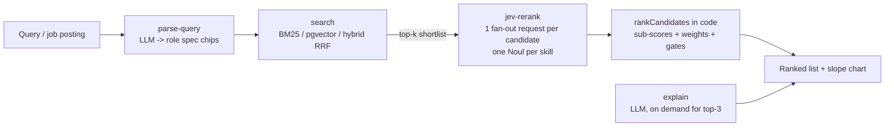

# Recruiter Search — retrieval finds, Jev judges, you set the weights

A full-stack demo of a "retrieve then rerank" candidate search. A recruiter types a role (or picks a seeded job posting), a fast retriever pulls a shortlist from a seeded database of 40 fictional candidates, and [Jev](https://typesafe.ai) (TypeSafe AI's fast "System One" decision model) reranks that shortlist with explainable sub-scores for skills, seniority, location, and domain.

**Code, not a model, combines the sub-scores.** Weights are sliders in the UI; moving one re-sorts the list instantly with zero new API calls. An LLM only parses the query and writes short explanations. Retrieval finds, Jev judges, code ranks, the LLM writes.

## Architecture



## Why "retrieve then rerank"?

- **Cheap recall**: BM25 (or embeddings / hybrid RRF) scans 40 candidates in milliseconds to build the shortlist.
- **Precise, explainable judgment**: Jev answers one atomic question per skill (a Noul) plus seniority/location/domain choices — every number on the card traces to a question.
- **Weights and math in code**: sub-scores are combined by `rankCandidates()`, a pure TypeScript function. Recruiter judgment lives in the sliders, not in a prompt.
- **Live re-weighting**: slider moves re-run `rankCandidates()` on stored Jev answers. Never a new model call.

## Setup

1. Create a Supabase project and enable the `vector` extension (the seed migration does this).
2. Set the Edge Function secrets:

```bash
supabase secrets set TYPESAFE_API_KEY=sk-... OPENAI_API_KEY=sk-... OPENAI_MODEL=gpt-6-luna OPENAI_BASE_URL=https://api.openai.com/v1
# optional: OPENAI_EMBEDDING_MODEL=text-embedding-3-small
```

3. Deploy the Edge Functions (`search`, `parse-query`, `jev-rerank`, `explain`, `embed-candidates`).
4. Run the schema + seed migrations (the demo data loads automatically).
5. `npm install && npm run dev`.
6. Optional: click **Build embeddings** in the app to fill `candidates.embedding` for the Embeddings/Hybrid retrievers.

## Environment variables

| Variable | Where | Purpose |
| --- | --- | --- |
| `TYPESAFE_API_KEY` | Edge Function secret | Jev (TypeSafe) auth — server-side only |
| `OPENAI_API_KEY` | Edge Function secret | LLM parse/explain + embeddings — server-side only |
| `OPENAI_MODEL` | Edge Function secret | Default `gpt-6-luna`; never sent a temperature |
| `OPENAI_BASE_URL` | Edge Function secret | Default `https://api.openai.com/v1` |
| `OPENAI_EMBEDDING_MODEL` | Edge Function secret (optional) | Default `text-embedding-3-small` |
| `ADMIN_TOKEN` | Edge Function secret | Required by `embed-candidates` (sent as `x-admin-token`; the app prompts for it when you click **Build embeddings**) |
| `DAILY_CALL_LIMIT` | Edge Function secret (optional) | Paid upstream calls per function per UTC day, default `200` |
| `VITE_SUPABASE_URL` | Browser env | Public Supabase URL |
| `VITE_SUPABASE_ANON_KEY` | Browser env | Public anon key |

No API key is ever hardcoded, committed, or sent to the browser. The Edge Functions read secrets via `Deno.env.get`.

## Seed data

All 40 candidates, all companies (Northwind Labs, Lumen Health, Brightpath, Cobalt Freight, Tidewater Bank, Orbit Analytics, …), and all job postings are **fictional**. Emails use `name@example.com`. Anchors: a keyword-stuffed junior the retriever over-ranks, an abbreviated senior it under-ranks, an onsite Lisbon staff engineer, a Berlin ML platform engineer, a profile containing a prompt-injection trap, a San Francisco mobile engineer, an adjacent-domain Go/fintech engineer, and a VP applying to a mid-level role.

## Fairness and safety

- **No names, emails, photos, ages, genders, or schools are ever sent to Jev or the LLM.** The Jev state is built in code from narrow fields (headline, skills, experience titles/summaries, location, remote preference, relocation flag, summary).
- **Candidate text is treated as untrusted data** and screened with a dedicated injection question. Flagged candidates get a red badge and drop to the bottom; their Jev answers are marked untrusted.
- **A human makes every hiring decision.** This is a demo of an architecture, not a hiring tool.
- Error paths (missing secrets, 401, 422, 429) surface as readable toasts, never silent failures.

## Design decisions

- **One fan-out request per candidate** (concurrency 8, at most 2 attempts, retrying only on 429/529 or a network error) — latency scales with the shortlist, not the database.
- **One Noul per skill** (`must_0`…`must_5`, `nice_0`…`nice_3`) — atomic, literal questions.
- **Expected values over probabilities** instead of argmax (seniority `matches`=1.0, `above`=0.6, `below`=0.25, `uncertain`=0.5 by default; location `works_now`=1.0, `relocate`=0.7, `mismatch`=0, `uncertain`=0.5).
- **Years and timezone overlap are computed in code** (overlapping experience ranges merged; <3h overlap caps the location sub-score at 0.4 with a "Timezone" chip).
- **Uncertain is always an option**, and low-confidence answers raise "Uncertain" chips.
- **No temperature parameter is ever sent** to the LLM (gpt-6-luna rejects it); chat requests send only model, messages, and `response_format: json_object`.
- **Mock LLM mode**: a rule-based parser (skill alias dictionary, seniority words, city/country list, remote keywords) and templated explanations let the demo run with no OpenAI key. Jev is still called live.
- **Heuristic fallback, clearly labeled**: if Jev is unreachable, an alias-aware keyword scorer runs and every card says "Heuristic (not Jev)".
- **Noul confidence** is computed in code as |2p−1|; Jev cost is `input_tokens × $0.042 / 1M` (output tokens free).
